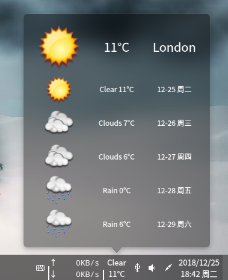
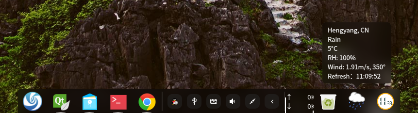
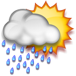
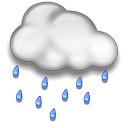
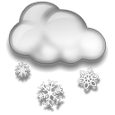
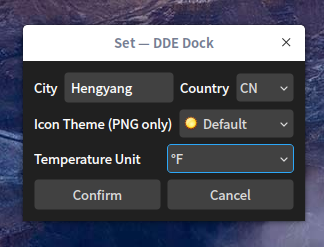
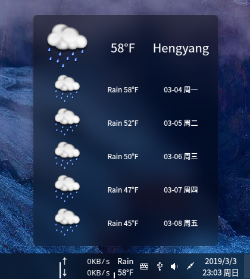
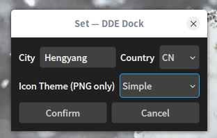

# DDE_Dock_Weather
Deepin Linux DDE-Dock weather forcast plugin.  
[Releases](../../releases/)  
install：./install.sh  
uninstall：./uninstall.sh  
### Build Dependences
Debian: `apt install gxde-dock-dev qt5-default libdtkwidget-dev`

  
  

### Problem
Project ERROR: dtkwidget development package not found
`apt-get install libdtkwidget-dev`

### Icon Name Rule

| Weather | Day | Night | Image |
| :-----: | :-: | :---: | :---: |
| Clear | 01d.png | 01n.png |  |
| Clouds | 02d.png | 02n.png |  |
| Clouds | 04d.png | 04n.png |  |
| Clouds | 04d.png | 04n.png |  |
| Rain | 09d.png | 09n.png |  |
| Rain | 10d.png | 10n.png |  |
| Thunder | 11d.png | 11n.png |  |
| Snow | 13d.png | 13n.png|  |
| Fog | 50d.png | 50n.png |  |
| NA | na.png | na.png |  |

#### Because the night time is not very accurate, we use the same icon for day and night.
### 5.4 (2019-03-03)
Add temperature unit set:  

### 5.3 (2019-01-07)
* Support icon theme  

### 5.0 (2018-12-19)
* Change API to https://openweathermap.org to support world wide weather forcast.

### Internationalization

All UI strings are written in English and wrapped in `tr()`. Translations are
`translations/zh_CN.ts` (Chinese) and `translations/en_US.ts` (English). The
build runs `lrelease` automatically and embeds the `.qm` files into the plugin,
so installing `libHTYWeather.so` alone is enough. Chinese locales use `zh_CN`;
all other locales use English. The OpenWeatherMap language, city names and
weekday names follow the same locale.

* `translations/translate_update.sh` — update the `.ts` files after editing sources
* `translations/translate_generation.sh` — generate `.qm` files manually for testing